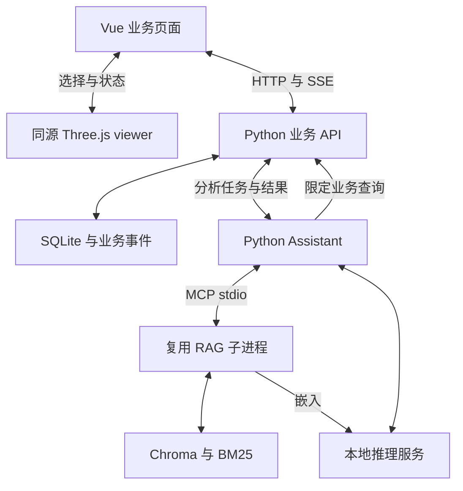
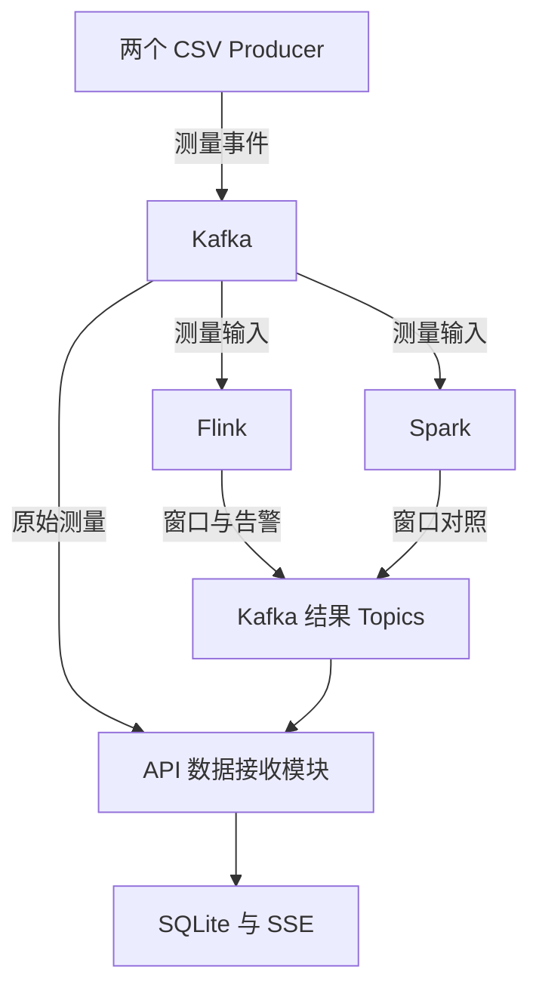

# GT Lifecycle Lab 完整项目方案

## 版本与项目定位

版本：2.0；日期：2026-11-03（Asia/Shanghai）。本版整合此前方案和用户确认的源码复用路线，替代 v1 中以静态 GLB 为主要展示路径、首版优先适配 Milvus Lite 的安排。

项目名称：**GT Lifecycle Lab｜燃气轮机数字化样机与智能运维实验平台**。

项目用于教学、工程能力验证和面试演示，核心场景是负荷变化下的性能异常分析。通过通用燃机教学结构、可复现合成数据和带来源的专业资料，串起监测、异常、数据查询、知识检索、检查建议和检修事件。它不是制造商真实 CAD、经过工业标定的数字孪生，也不直接控制设备。

本文为正式仓库的完整执行规格，由 v2 交接材料迁入。任务的实际状态只查 TASKS.md；接入准备结果另见 evidence/M0-00/preparation/ 下记录。完整上游克隆、应用实现和正式硬验收由本地 dsh-superagent 实际完成。已有 GLB 解析记录只证明资产离线检查，不替代浏览器或业务验收。

## 1. 目标与根本原则

最终业务主线：**实时监测 → 异常发现 → 查询运行数据和专业资料 → 生成有证据的检查建议 → 关联检修工单 → 形成部件事件 → 回查数据来源。**

用户确认的约束：

1. 前后端分离；前端 Vue 与 Three.js，后端 Python。
2. 项目在 WSL 的 `/home/lsy/workspace/lab` 下开发，容器使用 Windows Docker Desktop 的 Linux 引擎。
3. 应用代码、测试代码、提交和推送由用户已配置的本地 dsh-superagent 执行。
4. 三维前端与 RAG 直接克隆已选上游，参考并二次开发。
5. 先跑通主流程，再叠加功能；一次一个依赖满足的任务。
6. 编码前冻结硬验收；逐条验证、修复缺项；全部通过并形成可核查基线后锁定。

技术栈定为 Vue 3、TypeScript、Vite、Apache ECharts 与复用的 Three.js 查看器；后端使用 Python/FastAPI，业务持久化先用 SQLite，页面实时通道使用 SSE。各自依赖版本与锁文件在对应基线任务中实际核实，避免同时升级上游依赖并引入业务改动。

| 设计项 | v2 安排 |
|---|---|
| 三维运行路径 | 保留 turbine-explorer 完整源程序；Vue 同源嵌入 viewer 并接入业务 |
| GLB | 可交换资产和结构快照，不强制替代源程序 |
| RAG | 复用完整 MODULAR-RAG-MCP-SERVER；首版 Chroma、BM25、MCP stdio |
| Milvus Lite | 后续可选适配，不是首版必做条件 |
| 部署 | Vue 静态前端与 Python API 独立构建、独立运行；API 不托管前端 dist、不放入 Spark |
| 基线 | 增加 FE-BASE、FE-INTEGRATE、RAG-BASE、RAG-INTEGRATE；不继承上游完成勾选 |
| 容器数 | 按阶段增加必要角色，不以六容器建议限制职责划分 |

## 2. 用户故事与成功表现

1. 作为演示者，我希望设备和批次选择同步到模型、图表、告警和档案。
2. 作为使用者，我希望看到事件时间、接收时间、单位和连接状态，理解历史加速播放。
3. 作为使用者，我希望三维结构可旋转、缩放、剖视，并保留原项目核心效果。
4. 作为分析者，我希望从告警定位部件，也能从模型打开相应数据。
5. 作为使用者，我希望展示操作不会改变业务测量或运行状态。
6. 作为演示者，我希望重发、重启、重连后数据完整且不重复。
7. 作为使用者，我希望区分原始测量与事件时间窗口统计。
8. 作为验证者，我希望告警具有规则版本、触发依据、持续时间和原始事件。
9. 作为使用者，我希望分析任务固定设备、批次与时段，页面切换不影响已发起分析。
10. 作为分析者，我希望数值来自查询结果，专业解释来自可核查资料。
11. 作为使用者，我希望看到工具调用、证据、候选原因、检查项和缺失信息。
12. 作为资料维护者，我希望管理知识来源与版本，更新后仍可核查旧分析引用。
13. 作为使用者，我希望模型不可用、检索失败、无匹配资料分别显示。
14. 作为演示者，我希望从告警创建工单，完成后形成部件履历。
15. 作为验证者，我希望 Flink、Spark 与独立参考计算可比较。
16. 作为建模者，我希望按独立运行批次评估正常基线，明确合成验证范围。
17. 作为开发者，我希望编码前就有输入、期望、验证方法和证据要求。
18. 作为验收者，我希望必要项未运行、跳过或失败时不能标记完成。
19. 作为维护者，我希望复用代码保留来源，本地修改可追溯。
20. 作为面试者，我希望 JD 能力对应页面、代码、批次和验收记录。

M0 完成只代表监测主线通过；M1 完成代表最小智能运维闭环通过；完整交付还包括 M2～M4。

## 3. 源码复用与新增能力

### 三维前端

上游：[AlexZhangji/turbine-explorer](https://github.com/AlexZhangji/turbine-explorer)。固定提交：`efc5d2ecd12055f880a41b47215791c22d3656d4`。

该版本使用 Vite、TypeScript、Three.js，尚未使用 Vue。几何、材质、镜头、机壳拆分、部件检视等作为二次开发基础保留。源程序存在整页 DOM、尺寸和样式依赖，首版采用 Vue 业务壳与同源 viewer，不要求先全面改造成原生 Vue 三维组件。[F1][F2]

本项目增加业务部件映射、消息桥接、运行状态着色、告警定位、图表与档案联动、生命周期清理。原版具有部分部件检视能力，不等于所有目标业务部件已可点击。

### RAG

上游：[jerry-ai-dev/MODULAR-RAG-MCP-SERVER](https://github.com/jerry-ai-dev/MODULAR-RAG-MCP-SERVER)。固定提交：`f658c5a4011c8b826707a65a3b11ce9301b0626f`。

复用摄取、切分、Chroma、BM25、混合检索、追踪和 MCP stdio；Streamlit 保留为可选开发管理入口。Vue 先实现业务分析必需界面，不重复移植整个管理平台。[R1][R2]

新增燃机资料元数据和过滤、稳定结构化引用、版本定位、实际业务工具、分析追踪、检查建议与工单关联。上游 RAG 工具不等于产品内的运维 Agent。

### 基线、导入与许可

本机完整克隆上游后，以固定提交和 Git subtree 纳入唯一主仓库。参考克隆用于比对，主仓库保存实际二次开发源码。升级上游需要独立变更任务和回归，不自动跟随 main。

记录 URL、完整 SHA、依赖锁、许可、导入位置、原版结果和本地补丁。三维保留 MIT 与第三方说明；RAG 项目配置声明 MIT，但本次读取的树未发现独立 LICENSE 文件，应归档现有声明并核实完整版权信息，不自行制造原作者授权。[F1][R3]

详细源码事实、接入缺口和来源见 `docs/UPSTREAM_REUSE.md`。

## 4. 总体架构

### 页面与分析

API 管理设备、运行、测量、告警、检修和分析索引，提供 HTTP/SSE 并控制写入一致性。Assistant 负责受约束工具编排与模型调用；RAG 负责资料摄取和检索，不直接写业务数据库。

M1 中 RAG 是 Assistant 管理的长期子进程，使用独立工作目录和依赖环境，二者在同一容器/运行单元。stdio 不用于跨容器网络通信。API 与 Assistant 通过内部 HTTP 通信，浏览器只连接业务 API。

本地推理服务提供生成和嵌入能力，优先使用上游已实现的 Ollama provider。端点、模型、量化、嵌入维度及 GPU 可用性在本机确认。开发用 dsh 模型与产品运行时模型分别管理。

### 消息与流计算

M0 CSV 通过 HTTP 进入业务契约；M2 增加 Kafka 输入，API、Flink、Spark 各有消费组。消息接收、计算、持久化与页面推送分别确认。

M3 最终由 Flink 产生主告警，Spark 提供同窗对照。早期 Python 教学规则到 Flink 的主权切换有独立验收，不能产生双份主告警。

## 5. 页面与三维交互

导航为运行总览、设备档案、智能分析、检修管理、数据验证；另有结构学习入口复用原版教学展示。各阶段只启用实际完成的功能。

视觉采用深蓝背景、金属灰模型、青色趋势；关注用琥珀色，告警用红色，数据未知单独显示。颜色配合文字，图表均有标题、单位和时间范围。中央模型约占半宽，桌面布局以 1920×1080 验收，帧率另行实测。

| 位置 | 内容 | 交互 |
|---|---|---|
| 顶部 | 设备、批次、播放速度、运行/连接状态、确认数、最近接收时间 | 统一页面上下文；全局日志入口 |
| 左上 | 功率、负荷、燃料流量 | 时间范围联动 |
| 左中 | 压气机进口温度、出口压力 | 点击测点定位部件 |
| 左下 | 实际、正常预测、残差 | 模型版本和计算依据，M3 启用 |
| 中央 | 通用工业燃机结构 | 旋转、缩放、剖视、选件、来源说明 |
| 右上 | 多点排温及温差 | 异常测点定位与历史 |
| 右中 | 轴承温度、振动、当前告警 | 告警及分析范围 |
| 右下 | 原始记录表 | 固定表头、平滑滚动；悬停只停滚动，接收继续 |
| 底部 | 生命周期与检修事件 | 打开档案、资料、工单 |

原始数据在提交后更新；窗口统计按实际引擎输出更新，显示起止、引擎、版本和状态。窗口结果不能伪装为一秒测量值。

首版业务部件 ID 为 compressor、combustor、turbine、bearing_front、exhaust。测点与几何的教学映射明确登记。无对应测点或几何时显示不可用，不虚构位置。展示状态包括镜头、机壳、展开与动画；业务状态包括设备、批次、测量和告警。展示操作不能修改业务状态。

### viewer 消息契约

| 类型 | 方向 | 用途 |
|---|---|---|
| viewer-ready | viewer → Vue | 实例可接收状态 |
| select-component | Vue → viewer | 图表/告警定位部件 |
| component-selected | viewer → Vue | 回报部件选择 |
| update-component-state | Vue → viewer | 设置上下文、状态、测量与更新时间 |

公共字段为 schema_version、type、viewer_instance_id、context_revision、payload；业务消息还带 run_id/device_id。Vue 管理设备/批次，切换范围时递增 context_revision。双方校验 origin、source、结构与上下文，使用明确 targetOrigin；旧实例或旧范围消息不能污染当前页面。[W1]

初始化例外：Vue 为每次挂载分配 viewer_instance_id 并传入 viewer。viewer-ready 可带空 context_revision，不要求未知的 run/device。父端校验实例后发送当前 update-component-state 快照；子端绑定上下文后才回传业务选择。应用控制的重载按卸载旧 iframe、建立新实例处理；ready 后重发当前快照，避免初始化前发出消息丢失。

update-component-state 是父端更新业务上下文的唯一消息。通过 origin、source、实例及载荷校验后：尚未绑定时采用该完整快照；revision 大于当前值时，子端清除旧业务状态并采用新 run/device/context；相等时要求 run/device 相同；小于当前值时拒绝。其他业务消息必须与已绑定上下文完全匹配。普通部件选择不递增 context_revision。设备/批次切换须在不重建 iframe 的情况下生效，迟到的旧快照不能回滚上下文。

未知部件返回可处理状态，选择请求以请求标识防止重复回调；父页面卸载清理监听。iframe 从自己的前端 /viewer/ 加载，不依赖作者演示网站。完整源码与本地修改由同一主仓库追踪。

## 6. 领域数据与时间语义

| 对象 | 内容与关联 |
|---|---|
| Device / Component | 设备、部件、教学型号、安装信息、几何与测点映射、档案 |
| Run | 批次、场景、输入哈希、播放速度、预期数、实际确认数和状态 |
| MeasurementEvent | 唯一事件、测量时间、发送/接收时间、测量和质量 |
| StreamEvent | 持久游标、业务类型/对象、提交时间 |
| WindowResult | 设备/批次、窗口、引擎、算法版本、修订号和统计值 |
| Alarm | 规则版本、条件起点、触发/恢复、原始事件、状态 |
| KnowledgeDocument / Chunk | 来源、版本、哈希、机型/部件范围、章节/可靠页码/片段 |
| Analysis | 固定范围、工具记录、证据、模型/提示词版本、结果和状态 |
| WorkOrder / LifecycleEvent | 告警/分析/部件关联、检查处理、完成事件与来源 |
| Trace / Log | 运行/设备/事件/分析关联、组件、级别、实际时间和原文 |

### 测量信封

包含 schema_version、run_id、device_id、event_id、source_sequence、event_time、sent_at、metrics、quality_flags。服务端添加 received_at 和 request_id/trace_id。

测量覆盖功率 MW、负荷 %、转速 rpm、燃料质量流量 kg/s、压气机进口温度 °C、出口压力及绝压/表压定义、多点排温 °C、轴承温度 °C、振动速度有效值 mm/s。字段字典在任务编码前冻结，不混用单位或压力基准。

业务唯一键为 (run_id, device_id, event_id)。相同业务内容重试只留一条；同键测量或 event_time 冲突应拒绝。sent_at 等传输重试字段不参与业务相等判断，发送尝试另行留痕。

event_time 是测量时刻，sent_at 是本次发送，received_at 是实际接收。输入时间含时区，内部按 UTC 比较，页面标记显示时区。加速播放不改 event_time。传输耗时根据本次发送与接收时刻计算并注明时钟条件，历史测量时间到当前墙钟时间不称为网络延迟。

历史范围使用 [from, to)，按 event_time、source_sequence、event_id 稳定排序；最新值不因新到达旧事件回退。迟到记录存档并标识。

### SSE

业务记录与对应 StreamEvent 在同一受控事务提交，提交后才成功响应/推送。持久递增 stream_seq 用于补读，event_id 用于业务去重；过滤后的流序号允许不连续。

首次取得同一一致性视图的范围快照和游标 S，随后订阅 >S，先补齐已存在事件再等待新事件。重连使用已保存的 stream_seq。错误、未来或不可用游标执行冻结协议，不静默跳到最新。切换范围关闭旧订阅并校验响应上下文。

## 7. 合成数据、告警与正常基线

### 数据用途

F120 是固定工程验收夹具，验证数量、时间、幂等、补读和教学告警；不用于声称真实燃机物理精度。固定 CSV 不包含每次变化的 run_id/sent_at，由播放器注入。

业务演示数据使用可复现生成器，记录种子、场景范围、参数版本、哈希与预期现象。负荷、功率、燃料、环境、排气温度与压气机参数体现明确教学关系，不能把所有测点独立随机生成。

场景包括稳定运行、负荷爬升/下降、环境变化、排气温差增大、传感器偏移/缺测、振动升高，以及重复/乱序/迟到。1 Hz 数据用于趋势、统计和持续时间；若增加振动频谱，另提供高采样率波形与采样定义。

### 教学告警

R1：四排温 max-min >30°C 连续满 3 秒事件时间后触发；active 时 <25°C 连续满 2 秒后恢复。25～30°C 含边界维持已确认状态并中断候选计时。连续有效间隔为 1 秒；缺口/质量无效中断候选计时，既有告警保持 active，同时数据质量可为 unknown。

F120 超限始于 i=60，triggered_at 为 i=63；恢复条件始于 i=80，resolved_at 为 i=82。条件起点和确认时刻分开。重复不推进计时；M0 对迟到只存档，不重写已发布告警。

M3 独立验收主告警切换到 Flink：固定乱序/迟到语义、规则版本、旧告警收尾和新运行启用方式。一个运行不能由 Python 与 Flink 各生成一份主告警；Spark 不生产主告警。

### 正常运行基线

根据负荷、环境/进口温度等预测正常排温或燃料消耗，显示实际、预测和残差。先比较简单参考模型，再决定复杂模型的增量。

训练、验证、测试按独立运行批次划分；预处理仅在训练集拟合，异常测试场景不泄漏进入正常训练。保存模型、特征、样本范围、误差、残差阈值和适用条件。误差门槛及检出/误报评价在编码前冻结。结论只适用于已记录的合成场景。

## 8. RAG、运维 Agent 与检修闭环

### 知识库

首版使用有限、可核查的公开资料和明确标注的自编教学案例。保存来源 URL/标题、取得日期、版本、内容哈希、适用机型/部件、章节或可靠页码。格式以实际验证的导入路径为准，不承诺未经验证的任意格式。

沿用文本摄取；首版关闭视觉、LLM 分块增强和 LLM 元数据增强，重排关闭。Chroma 与 BM25 的版本、删除、重复导入和重启持久化一起验收。嵌入模型或维度改变需新索引版本或明确重建，不能混用旧向量。

混合检索补充简单可验证的型号、部件、版本过滤，并明确通用教学资料的适用规则。返回结构化 citations 和 trace_id；每条引用统一使用 document_id、document_version、chunk_id、source_uri、title、locator、snippet、retrieval_score。字段类型与缺失值规则在 M1-02 编码前冻结。上游 Citation.source 经资料登记表映射为项目 source_uri，不把容器本地路径直接返回为用户链接。检索分数不解释为故障概率；不能确认页码时使用可靠章节或片段定位。

源码接入事项：真正 MCP 入口是 `python -m src.mcp_server.server`；根 main.py 是占位入口；需要透传 filters，补机器可读引用和失败语义。具体源码见复用审计。[R3][R4][R5]

### 工具与分析

| 工具 | 内容 |
|---|---|
| get_device_history | 固定设备、批次、时段的原始历史、单位和质量 |
| get_window_results | 指定窗口/引擎/版本的已产生结果；M3 前明确尚无结果 |
| get_alarm_events | 触发、恢复、持续时间与原始事件 |
| search_knowledge | 真实 MCP 检索结果、结构化引用与追踪 |
| get_maintenance_records | 指定部件的检修履历与资料版本 |

点击分析时冻结设备、批次、时段和告警上下文，生成 analysis_id；后续页面切换不改变它。工具范围、调用轮次和超时在开工前冻结。产品分析不开放任意 SQL 或 Shell。

输出包含数据现象、资料证据、候选原因、检查项和缺失信息。数值绑定 tool_call_id/结果，文字依据绑定文档/片段。展示实际工具参数、范围、状态和耗时，不展示或编造内部思考过程。

模型/工具失败、检索失败、无匹配资料和数据不足分别表示，已取得证据可保留，不用预置答案伪装成功。固定问题集验证关键事实、引用和范围，允许生成表述变化。

### 部件档案与工单

档案保存安装、测点、文档版本和历史事件；设计/制造/投运可先用带来源的教学档案，运行、告警、分析与检修操作实际生成。

从分析结果创建工单，关联 alarm_id、analysis_id、device_id、component_id 与文档版本。状态为待检查、处理中、已完成、已取消；完成时保存检查结果、处理说明、操作者和时间，生成部件事件。重复请求用幂等键，不重复生成事件。模型给建议，工单变更由明确页面操作触发。

## 9. Python 接口与日志

本版默认 FastAPI，兼容版本在 M0-00/M0-01 核实锁定；OpenAPI 为契约来源。下表为设计接口，不代表已有服务。

| 接口组 | 设计行为 |
|---|---|
| GET /api/v1/health | 实际版本、服务与必要依赖状态 |
| /api/v1/devices 与部件查询 | 设备、部件、测点关系 |
| POST /api/v1/runs、/events | 创建运行、接收事件、返回真实确认 |
| /api/v1/history、/latest、/snapshots | 统一范围查询与一致性快照 |
| /api/v1/stream | SSE 游标与范围补读 |
| /api/v1/alarms、/window-results | 告警和统计版本 |
| /api/v1/logs | 按关联 ID、组件、级别、时段、关键词分页 |
| POST /api/v1/analyses 及结果查询 | 分析任务、工具记录、引用和状态 |
| 工单与部件事件接口 | 幂等创建、合法状态变更、履历查询 |

新事件 201、幂等重复 200、业务冲突 409、无效输入 422；错误带追踪 ID。具体字段、错误协议和实际验证命令在对应任务前提交冻结。只实现当前阶段需要的接口，不提前铺设未工作的空接口。

数据行日志自动带 run_id/device_id/event_id，分析日志另带 analysis_id；顶部有全局入口。显示实际时间、原文与简短中文说明。

| 阶段 | 真实日志 |
|---|---|
| M0 | HTTP 发送确认、校验、持久化、推送、告警和查询 |
| M1 | 摄取/检索追踪、模型请求、工具调用、引用、分析与工单 |
| M2 | Kafka Topic/Partition/Offset、发送确认、消费、幂等及恢复 |
| M3 | 引擎输入、迟到/去重、窗口范围与版本、主告警切换 |

未发生处理不生成成功占位日志。凭据不进入日志/Git；大体量数据库和运行日志放持久目录，仓库保存必要脱敏验收证据与哈希。

## 10. Kafka、Flink、Spark

M2 两 Producer 回放两设备 CSV；以 device_id 为分区键并保留事件序号。分区顺序不等于全局事件时间顺序。Kafka offset 不能代替业务 event_id。

消费者在持久化成功后提交消费进度，允许重放并通过业务唯一键去重。验收目标是恢复后业务完整且无重复，不因打开单个组件的选项就声称 Kafka、SQLite、SSE 已端到端 exactly-once。

原始测量、窗口结果、告警分 Topic；引擎只订阅对应测量输入。结束和控制信息使用明确信封，不伪装测量值。

M3 先做 UTC 对齐 60 秒半开窗口。开工前固定去重、无效值、统计量、乱序容忍、watermark、允许迟到、超迟到和结果修订策略。Flink/Spark 使用相同业务定义，与独立离线参考答案比较。

有限回放必须验证末尾窗口结束、空闲分区处理。机制在编码前冻结，不能把未完成窗口标完成，也不能伪造测量推进时间。结果按 run/device/window/metric/version 对齐，区分临时与最终状态，浮点容差预先确定。保留两引擎原结果、差值与独立答案。

## 11. WSL、Docker 与资源

主 checkout 为 `/home/lsy/workspace/lab/gas-turbine-lifecycle-lab`；Ticket 工作树在同一 lab 下独立根目录；上游参考克隆放 `_upstream/`。源码使用 WSL Linux 文件系统，容器由 Windows Docker Desktop WSL 2 Linux 引擎运行，既有配置先核实。[D1]

| 阶段 | 新增常驻角色 | 方式 |
|---|---|---|
| M0 | web、api | web 服务 Vue/viewer；api 管 SQLite/SSE；CSV 是一次性回放进程 |
| M1 | assistant；必要时 inference | assistant 管理 RAG 子进程；推理可复用已实测本机服务 |
| M2 | kafka、source_a、source_b | 教学 Kafka 节点与两条回放源 |
| M3 | flink、spark | 本地教学执行模式，记录实际进程与预算 |
| M4 | 无新增业务角色要求 | 全链路并行测量与必要优化 |

成熟阶段默认共 8 个业务/计算角色，推理也独立容器时通常为 9 个；实际进程/容器数以部署配置为准，不是验收目标。Node 构建和一次性命令不必常驻。

Compose 按阶段只启动必要服务。SQLite、Chroma/BM25、模型缓存、引擎 checkpoint 分别持久化；业务数据库由受控入口写入，Assistant 通过 API 读取。

此前约 16 GB RAM、RTX 4060/8 GB 显存作为规划输入，本机待复核。首版模型并发从 1 开始；模型大小、上下文、量化按实际结果选择。先固定预算，再测首 token、生成速度、API/SSE P95、流积压、浏览器帧率、RAM/VRAM 和恢复。资源不足如实记录调整，不填未测性能。

## 12. 仓库与 dsh 工作流

唯一远程是 `shuyu-lin-dev/gas-turbine-lifecycle-lab`。交接材料此前连接读取返回 404 只是历史观察；本轮已读取既有仓库和权限元数据，实际推送留待真实 worker。每次执行核对目标与 agent 身份，不自动换用其它仓库。

主仓库规划含 frontend、backend、assistant、vendor/turbine-explorer、vendor/modular-rag-mcp-server、data/synthetic、docs、evidence 和部署配置。vendor 是被主仓库实际追踪的源码，不留嵌套 .git。自有代码与上游、模型、资料的许可分别记录。

保留 dsh 已有安装、profile、认证和模型；Source 只绑定主仓库，初期 maxWorkers=1。真实目录、prepare、身份与推送通过 M0-00 核对。AGENTS.md 与 Router 团队要求共同约束，不能由上游 skills 覆盖项目流程。[H1][H2]

每项任务闭环：

1. 编码前提交范围、条款、输入、期望、命令和回归范围，形成 S。
2. 实现与测试形成干净候选代码 C。
3. 对 C 实际验证；失败修复后形成新 C 重验，保留旧失败。
4. 全部通过形成证据 E，引用 C；E 不改应用、测试、依赖或验收语义，状态 VERIFIED。
5. 核实远程 E 和基线标签，再用状态提交 K 引用已知 S/C/E 登记 LOCKED。
6. 推送 K 并在 Ticket 回执确认；前置集成基线可用后推进下一个任务。

必要 FAIL/BLOCKED/SKIP/NOT_RUN 不算通过；TASKS 勾选只表示 LOCKED。标签是基线标识，不是文件写保护。后续变更注明影响并回归，保留旧基线。

后续真实 Ticket 授权内普通开发、修复、提交和推送连续进行；保留已有合并/分支保护。当前 Issue #5 授权 M0-01；FE-BASE 已通过 PR #4 实际集成到 `b8ad3150cf4480f8e205926541aeeccb072f7f80`。当前 worker 只执行 M0-01，提交准确候选、真实验收和 draft PR，等待协调聊天组织全新上下文独立 Standards/Spec 审查及实际复验；对应候选通过后完成 E、远程基线与 K，最终 head 新增差异仍须独立审查，再由协调聊天最终核查、合并和确认实际集成。后续任务单独派发。提交、推送、合并分别记录，开 PR 不等于完成。细则由 AGENTS.md、docs/agents/dsh.md 与 docs/agents/workflow.md 管理。

## 13. 阶段与里程碑

共 27 个依赖任务，状态与条款映射以 TASKS.md 为单一记录。阶段目标不表示同时开工。

| 阶段 | 任务范围 | 结果 |
|---|---|---|
| M0 | M0-00、FE-BASE、M0-01、FE-INTEGRATE、M0-02～M0-07 | 单设备监测、原始记录、三维联动、教学告警、追溯 |
| M1 | RAG-BASE、M1-01、M1-02、RAG-INTEGRATE、M1-03～M1-05 | 带引用分析、检查建议、工单、部件事件 |
| M2 | M2-01～M2-03 | Kafka 双设备、故障恢复、消息来源 |
| M3 | M3-01～M3-04 | 同窗对照、告警切换、正常基线 |
| M4 | M4-01～M4-03 | 预算、性能稳定性和可复现交付 |

首项为 M0-00；FE-BASE 在 M0，RAG-BASE 在 M0 锁定后进入 M1。完整克隆是复用方式，不代表 M0 同时开发 RAG。

## 14. 验收与完成定义

逐条硬验收见 ACCEPTANCE.md。任务开工前还需登记本机命令、固定输入哈希、期望、环境、容差和回归范围。未冻结预算是开工前缺项，不能绕过后直接优化。

以调用方接口测试可观测行为；原版测试保留效果，新验收覆盖业务联动。真实浏览器、MCP、本地模型、Kafka、流引擎与持久化均按阶段验证，Mock 不替代必要真实路径。

报告逐条记录 ID、命令/操作、退出码、期望、实际、状态、证据和哈希、criteria_commit、tested_code_sha。状态计数完整，不以总测试数代替必要条款。缺功能补功能，失败修复后重验。

最终演示：选择负荷变化批次，发现并定位异常，查看趋势与基线差异，核对窗口，调用实际工具与资料，阅读引用和建议，创建并完成工单，回查原记录、Kafka 来源、引擎结果和 Agent 追踪。

## 15. JD 对应与最终交付

| 用户提供的岗位方向 | 能力 | 证据 |
|---|---|---|
| RAG | 版本、混合检索、过滤、引用 | 固定问题、实际引用、摄取/查询追踪 |
| Agent | 受约束业务工具与证据汇总 | 工具输入输出、范围、失败案例 |
| 工业时间序列 | 负荷场景、持续告警、正常基线 | 生成参数、运行批次、模型/规则评估 |
| Kafka | 双源、恢复、幂等 | Topic/Partition/Offset、故障和恢复 |
| Flink/Spark | 同窗统计与事件时间 | 独立 oracle、迟到/末窗用例、差异 |
| 本地部署 | WSL/Docker 与本地模型 | 实际版本、GPU/资源、真实调用 |
| 性能优化 | 基准、瓶颈与回归 | 同环境前后性能、资源与质量比较 |
| 工程交付 | 二次开发和可追溯任务 | 上游版本、补丁、报告、基线与复现 |

交付源码、上游来源、合成数据和生成器、依赖锁与部署、实际报告、演示脚本、架构、许可清单与证据表。README 区分复用和新增，不把原作者能力记为从零独立实现。

## 16. 边界、待核实与当前状态

首版不扩展复杂 PLM、多组织权限、任意 SQL Agent、生产高可用、完整多模态知识库或自动控制。Kafka/Flink/Spark、正常基线和本地性能保留在后续，不能因 M0 成功删去。

M0 核实目标仓库、dsh 版本/profile/端口、身份权限、活跃任务、目录、Docker 与依赖；M1 核实本地模型、维度、MCP 和小知识集；M3 冻结水位线/迟到、统计容差及告警迁移；M4 先冻结场景和资源/性能预算。

当前完成方案修订、源码只读核对和资产准备。完整上游本机克隆、绑定、开发和性能测试未在本会话执行，任务不能预先标通过。

## 17. 主要来源

这些来源支持上游和工具能力陈述；本项目接口、架构和验收为本版设计。

- [F1] [Turbine Explorer 固定版本与许可](https://github.com/AlexZhangji/turbine-explorer/tree/efc5d2ecd12055f880a41b47215791c22d3656d4)。
- [F2] [package.json](https://github.com/AlexZhangji/turbine-explorer/blob/efc5d2ecd12055f880a41b47215791c22d3656d4/package.json)；[main.ts](https://github.com/AlexZhangji/turbine-explorer/blob/efc5d2ecd12055f880a41b47215791c22d3656d4/src/main.ts)。
- [R1] [Modular RAG 固定版本](https://github.com/jerry-ai-dev/MODULAR-RAG-MCP-SERVER/tree/f658c5a4011c8b826707a65a3b11ce9301b0626f)。
- [R2] [向量存储注册](https://github.com/jerry-ai-dev/MODULAR-RAG-MCP-SERVER/blob/f658c5a4011c8b826707a65a3b11ce9301b0626f/src/libs/vector_store/__init__.py)；[Ollama 嵌入](https://github.com/jerry-ai-dev/MODULAR-RAG-MCP-SERVER/blob/f658c5a4011c8b826707a65a3b11ce9301b0626f/src/libs/embedding/ollama_embedding.py)。
- [R3] [RAG 包配置](https://github.com/jerry-ai-dev/MODULAR-RAG-MCP-SERVER/blob/f658c5a4011c8b826707a65a3b11ce9301b0626f/pyproject.toml)。
- [R4] [实际 MCP 入口](https://github.com/jerry-ai-dev/MODULAR-RAG-MCP-SERVER/blob/f658c5a4011c8b826707a65a3b11ce9301b0626f/src/mcp_server/server.py)；[占位入口](https://github.com/jerry-ai-dev/MODULAR-RAG-MCP-SERVER/blob/f658c5a4011c8b826707a65a3b11ce9301b0626f/main.py)。
- [R5] [查询工具](https://github.com/jerry-ai-dev/MODULAR-RAG-MCP-SERVER/blob/f658c5a4011c8b826707a65a3b11ce9301b0626f/src/mcp_server/tools/query_knowledge_hub.py)；[默认配置](https://github.com/jerry-ai-dev/MODULAR-RAG-MCP-SERVER/blob/f658c5a4011c8b826707a65a3b11ce9301b0626f/config/settings.yaml)。
- [D1] [Docker Desktop WSL 2](https://docs.docker.com/desktop/features/wsl/)。
- [W1] [MDN postMessage](https://developer.mozilla.org/en-US/docs/Web/API/Window/postMessage)。
- [H1] [dsh 执行与目录](https://github.com/deepseek-ai/dsh-superagent-prototype/blob/6337fc823ce20251c8de8085948165c81aaa701e/docs/003-execution.md)。
- [H2] [dsh 提示词与 AGENTS](https://github.com/deepseek-ai/dsh-superagent-prototype/blob/6337fc823ce20251c8de8085948165c81aaa701e/docs/004-prompts.md)。
